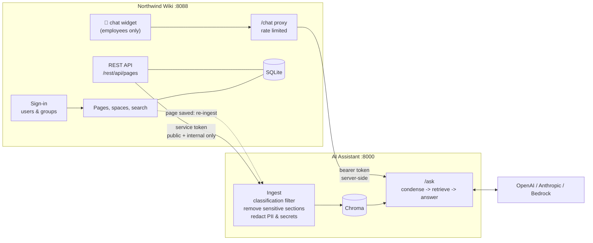

# Northwind Wiki + AI Assistant (RAG)

A realistic internal-knowledge platform:

- **Northwind Wiki** - a Confluence-like wiki: sign-in, spaces, pages, labels, versions, search, editing, users and groups, and page **classification** (public / internal / confidential).
- **AI Assistant** - a RAG chatbot that reads the wiki through its REST API, answers **only** from wiki pages with **citations that link back to the wiki**, and lives inside the wiki as a floating 💬 button.
- **Sensitive data never reaches the AI** - confidential pages, marked sensitive sections and secrets/personal data are filtered out, and leak tests prove it.
- **Runs three ways** - Python on your laptop, Docker Compose, or Kubernetes with Helm (local today, AWS EKS later).

> **Every step in this guide is written so that you can follow it from a fresh Windows laptop.** Do the parts in order. After each step there is a **✅ You should see** line - if you don't see it, check [Troubleshooting](#part-11---troubleshooting).

---

## Contents

- [Part 0 - What you are building](#part-0---what-you-are-building)
- [Part 1 - Install the tools (once)](#part-1---install-the-tools-once)
- [Part 2 - Create accounts and API keys (once)](#part-2---create-accounts-and-api-keys-once)
- [Part 3 - Get the code and configure it (once)](#part-3---get-the-code-and-configure-it-once)
- [Part 4 - Run the automated tests](#part-4---run-the-automated-tests)
- [Part 5 - Option A: run with Python](#part-5---option-a-run-with-python)
- [Part 6 - Option B: run with Docker Compose](#part-6---option-b-run-with-docker-compose)
- [Part 7 - Option C: run on Kubernetes (kind + Helm)](#part-7---option-c-run-on-kubernetes-kind--helm)
- [Part 8 - Test everything in the browser](#part-8---test-everything-in-the-browser)
- [Part 9 - Evaluation (quality and leak tests)](#part-9---evaluation-quality-and-leak-tests)
- [Part 10 - Daily start and stop](#part-10---daily-start-and-stop)
- [Part 11 - Troubleshooting](#part-11---troubleshooting)
- [Part 12 - Clean up](#part-12---clean-up)
- [Part 13 - AWS EKS (later)](#part-13---aws-eks-later)
- [Part 14 - Reference](#part-14---reference)

---

## Part 0 - What you are building



There are **two programs**:

| Port | Program | What it is | Do you open it? |
|---|---|---|---|
| **8088** | **Northwind Wiki** | The website with pages and the 💬 button | ✅ **Yes** - http://127.0.0.1:8088 |
| **8000** | **AI Assistant (RAG API)** | The AI backend that answers questions | ❌ No - the wiki talks to it |

### Users you can sign in as

| User | Role | Sees | Can edit | 💬 Assistant |
|---|---|---|---|---|
| **Karthik Kumar** ⭐ main user | Platform Admin (DevOps/SRE) | **Every page**, including all confidential | ✅ | ✅ |
| Asha Rao | Software Engineer | Public + internal | ✅ | ✅ |
| Ravi Menon | HR Business Partner | + Salary Bands 2026 | ✅ | ✅ |
| Meera Iyer | Security Lead | + Penetration Test Report 2026 | ✅ | ✅ |
| Arjun Shah | Finance Manager | + Budget FY2026 | ✅ | ✅ |
| Neha Kapoor | Product Manager | Public + internal | ✅ | ✅ |
| Vikram Singh | External Contractor | **Public pages only** | ❌ | ❌ |

| Page type | Who can see it |
|---|---|
| 🟢 Public | Everyone who is signed in |
| 🟡 Internal | Employees |
| 🔒 Confidential | Only the groups named on the page (for example HR) |
| Any page | Admins (Karthik) |

The AI assistant only learns from public and internal pages, and only employees can use it - so nobody can get something from the bot that they couldn't read in the wiki.

### How sensitive data is protected

| Layer | What happens | Example in the sample pages |
|---|---|---|
| 1. Page access | Users only see pages their groups allow | Salary Bands → HR and admins only |
| 2. API scope | The wiki never sends confidential pages to the AI | Pentest report, budget |
| 3. Connector check | The AI side also refuses confidential pages (double check) | - |
| 4. Sensitive sections | Text between `<!-- sensitive -->` and `<!-- /sensitive -->` is removed | Database password in a runbook |
| 5. Pattern redaction | Phone numbers, PAN, Aadhaar, card numbers, API keys, passwords are removed | An engineer's mobile number |
| 6. Assistant access | Only employees get the 💬 button | Contractor has no 💬 |
| 7. Leak tests | An automatic test fails if any secret appears in an answer | Part 9 |

---

## Part 1 - Install the tools (once)

You need these tools. Install them in this order.

| # | Tool | Needed for |
|---|---|---|
| 1.1 | Git for Windows (includes **Git Bash**) | Everything |
| 1.2 | Python 3.13 | Everything |
| 1.3 | WSL 2 | Docker Desktop (Options B and C) |
| 1.4 | Docker Desktop | Options B and C |
| 1.5 | Kubernetes in Docker Desktop (kind) | Option C |
| 1.6 | Helm | Option C |
| 1.7 | VS Code (optional, recommended) | Editing files |

> **Only want the quickest run?** Do 1.1 and 1.2, then skip to Part 2. You can install the rest later for Options B and C.

### 1.1 Install Git for Windows (gives you Git Bash)

1. Open **PowerShell**: press the **Windows key**, type `powershell`, press **Enter**.
2. Run:

```powershell
winget install --id Git.Git -e
```

3. Close PowerShell.
4. Open **Git Bash**: press the **Windows key**, type `git bash`, press **Enter**.

✅ **You should see** a black window with a prompt like `you@PC MINGW64 ~ $`.

Check:

```bash
git --version
```

✅ **You should see** `git version 2.x.x`.

> **How to paste into Git Bash:** right-click → **Paste**, or press **Shift + Insert**. `Ctrl+V` may not work.
>
> **From here on, run every command in Git Bash** unless the step says PowerShell.

### 1.2 Install Python 3.13

1. In **PowerShell**:

```powershell
winget install --id Python.Python.3.13 -e
```

2. Turn off the Windows "fake python" shortcut (otherwise `python` opens the Microsoft Store):
   Windows **Settings** → **Apps** → **Advanced app settings** → **App execution aliases** → turn **off** `python.exe` and `python3.exe`.
3. **Close and reopen Git Bash.**
4. Check:

```bash
python --version
```

✅ **You should see** `Python 3.13.x`.

### 1.3 Install WSL 2 (needed by Docker Desktop)

1. Open **PowerShell as Administrator**: Windows key → type `powershell` → right-click **Windows PowerShell** → **Run as administrator**.
2. Run:

```powershell
wsl --install
```

3. **Restart your computer** when it finishes.

✅ **You should see** after restart, `wsl --status` in PowerShell shows `Default Version: 2`.

### 1.4 Install Docker Desktop

1. In **PowerShell**:

```powershell
winget install --id Docker.DockerDesktop -e
```

2. Start **Docker Desktop** from the Start menu. Accept the terms. Signing in is optional (you can skip).
3. Wait until the bottom-left corner says **Engine running** (green).
4. Docker Desktop → ⚙️ **Settings** → **Resources** → give it at least **4 GB memory** → **Apply & restart**.
5. Docker Desktop → ⚙️ **Settings** → **General** → make sure **Use containerd for pulling and storing images** is **on** → **Apply & restart**.
6. In Git Bash:

```bash
docker --version
docker run --rm hello-world
```

✅ **You should see** `Docker version ...` and then `Hello from Docker!`.

### 1.5 Turn on Kubernetes in Docker Desktop (only for Option C)

1. Docker Desktop → **Kubernetes** (left menu) → **Create cluster**.
2. Choose **kind**, **1 node**, the default version → **Create**.
3. Wait until it shows the cluster is **running** (a few minutes).
4. In the Kubernetes settings, tick **Show system containers (advanced)** - needed later to load images into the cluster.
5. In Git Bash:

```bash
kubectl config current-context
kubectl get nodes
```

✅ **You should see** `docker-desktop` and a node `desktop-control-plane` with status `Ready`.

### 1.6 Install Helm (only for Option C)

1. In **PowerShell**:

```powershell
winget install --id Helm.Helm -e
```

2. Still in PowerShell, find where it was installed:

```powershell
(Get-Command helm).Source
```

✅ **You should see** a path ending in `\windows-amd64\helm.exe`, for example
`C:\Users\bakar\AppData\Local\Microsoft\WinGet\Packages\Helm.Helm_Microsoft.Winget.Source_8wekyb3d8bbwe\windows-amd64\helm.exe`

3. Make Git Bash find Helm. Take that path, **remove** `\helm.exe`, change `C:\` to `/c/` and every `\` to `/`. Then run in **Git Bash** (this example uses the path above - use yours):

```bash
echo 'export PATH="$PATH:/c/Users/bakar/AppData/Local/Microsoft/WinGet/Packages/Helm.Helm_Microsoft.Winget.Source_8wekyb3d8bbwe/windows-amd64"' >> ~/.bashrc
source ~/.bashrc
helm version
```

✅ **You should see** `version.BuildInfo{Version:"v3..." }` or `v4...`.

### 1.7 Install VS Code (optional)

```powershell
winget install --id Microsoft.VisualStudioCode -e
```

You can also edit files with Notepad - this guide shows both.

---

## Part 2 - Create accounts and API keys (once)

### 2.1 OpenAI (required)

The assistant uses OpenAI for **embeddings** (finding the right page) and **answers**.

1. Go to https://platform.openai.com and sign up or sign in.
2. **Add credit:** **Settings** → **Billing** → add a payment method and a small amount (for example $5). API calls do not work without credit. This project costs a few cents per day of testing.
3. **Create a project:** **Settings** → **Projects** → **Create project** → name it `ai-rag-chatbot`.
4. **Limit spending:** open the project → **Limits** → set a monthly budget, for example **$5**, and an email alert at **$3**.
5. **Allow the two models** (project → **Limits** → allowed models), at least:
   - `gpt-4o-mini` (answers)
   - `text-embedding-3-small` (embeddings)
6. **Create the API key:** select the `ai-rag-chatbot` project (top-left) → **API keys** → **Create new secret key** → name `ai-rag-chatbot-dev` → **Create**.
7. **Copy the key now** (it starts with `sk-`). It is shown only once. Keep it for Part 3.

### 2.2 Anthropic (optional)

Only if you want Claude to write the answers (`LLM_PROVIDER=anthropic`).

1. Go to https://platform.claude.com and sign in.
2. **Settings** → **Workspaces** → **Create workspace** → `ai-rag-chatbot`.
3. **Billing** → set a monthly spend limit (for example $5).
4. **API keys** → **Create key** → scope it to the `ai-rag-chatbot` workspace → copy the key (starts with `sk-ant-`).

> Anthropic has no embedding model. Even with Claude for answers, embeddings still come from OpenAI.

---

## Part 3 - Get the code and configure it (once)

### 3.1 Create the projects folder

```bash
mkdir -p "/d/AI Projects"
cd "/d/AI Projects"
```

> `/d/AI Projects` is `D:\AI Projects` in Windows Explorer. The quotes are needed because of the space. Use `/c/...` if you only have a C: drive.

### 3.2 Download the code

```bash
git clone https://github.com/KarthikKumarBA/ai-rag-chatbot.git
cd ai-rag-chatbot
ls
```

✅ **You should see** folders and files such as `app  wiki  helm  tests  Dockerfile  README.md`.

> Replace the URL if your repository has a different name or owner.

### 3.3 Create the Python environment

```bash
python -m venv .venv
source .venv/Scripts/activate
```

✅ **You should see** `(.venv)` at the start of your prompt. **Every time you open a new Git Bash window for this project, run the two lines in 3.6 first.**

Install the packages (takes a few minutes):

```bash
python -m pip install --upgrade pip
python -m pip install -r requirements-dev.txt
```

✅ **You should see** `Successfully installed ...` at the end, with no red `ERROR`.

### 3.4 Create your `.env` file (your settings and keys)

```bash
cp .env.example .env
```

Create two random tokens (passwords the two programs use to talk to each other):

```bash
python -c "import secrets; print('WIKI_API_TOKEN=' + secrets.token_urlsafe(32)); print('RAG_API_TOKEN=' + secrets.token_urlsafe(32))"
```

✅ **You should see** two lines like `WIKI_API_TOKEN=Xy3...` and `RAG_API_TOKEN=Ab9...`. Keep this window open.

Open `.env`:

```bash
notepad .env        # or: code .env   (VS Code)
```

Change **only these 4 lines** and save (**Ctrl+S**):

| Line in `.env` | Change it to |
|---|---|
| `OPENAI_API_KEY=your-openai-api-key` | `OPENAI_API_KEY=sk-...` (your key from 2.1) |
| `ANTHROPIC_API_KEY=your-anthropic-api-key` | your Claude key from 2.2, or leave it if you skipped 2.2 |
| `WIKI_API_TOKEN=your-generated-wiki-token` | the `WIKI_API_TOKEN=...` line printed above |
| `RAG_API_TOKEN=your-generated-rag-token` | the `RAG_API_TOKEN=...` line printed above |

Rules: no quotes, no spaces around `=`, one setting per line.

Check:

```bash
grep -E "^(OPENAI_API_KEY|WIKI_API_TOKEN|RAG_API_TOKEN)=" .env | sed 's/=.*/=<set>/'
grep -E "^(OPENAI_API_KEY|WIKI_API_TOKEN|RAG_API_TOKEN)=your-" .env || echo "OK - required values are set"
```

✅ **You should see** the three names followed by `=<set>`, and then `OK - required values are set`.

> `.env` contains your keys. It is listed in `.gitignore`, so Git never uploads it. Never share it.

### 3.5 Check the main settings (no change needed)

These are already set in `.env`:

| Setting | Value | Meaning |
|---|---|---|
| `LLM_PROVIDER` | `openai` | Who writes the answers |
| `OPENAI_MODEL_ID` | `gpt-4o-mini` | Fast and cheap model |
| `EMBEDDING_PROVIDER` | `openai` | Who creates embeddings |
| `DOCS_SOURCE` | `wiki` | The assistant reads from the wiki |

### 3.6 Every new Git Bash window: run these two lines first

```bash
cd "/d/AI Projects/ai-rag-chatbot"
source .venv/Scripts/activate
```

---

## Part 4 - Run the automated tests

These tests use fake AI models - **no API keys are used and nothing costs money**.

```bash
python -m pytest -q
```

✅ **You should see** a line of dots and `42 passed`.

If anything fails, stop here and check [Troubleshooting](#part-11---troubleshooting).

---

## Part 5 - Option A: run with Python

The simplest way. You need **two Git Bash windows** open at the same time.

### 5.1 Window 1 - start the wiki

Open a new Git Bash window and run:

```bash
cd "/d/AI Projects/ai-rag-chatbot"
source .venv/Scripts/activate
python -m uvicorn wiki.app:app --port 8088 --reload
```

✅ **You should see** `Uvicorn running on http://127.0.0.1:8088`. **Leave this window open.**

### 5.2 Window 2 - index the wiki

Open a second Git Bash window and run:

```bash
cd "/d/AI Projects/ai-rag-chatbot"
source .venv/Scripts/activate
python -m app.ingest
```

✅ **You should see**:

```
Indexed 13 documents into 59 chunks (collection: company_docs_openai)
Removed stale chunks:       0
Skipped restricted pages:   0
Sensitive sections removed: 1
Pattern redactions:         1
```

There are 16 pages. The wiki never sends the 3 confidential ones, so 13 are indexed.

### 5.3 Window 2 - start the AI assistant

In the same Window 2:

```bash
python -m uvicorn app.api:app --port 8000
```

✅ **You should see** `Warm-up complete in ...s` and then `Application startup complete`. **Leave this window open.**

### 5.4 Check both are running

Open a third Git Bash window:

```bash
curl -s http://127.0.0.1:8088/health; echo
curl -s http://127.0.0.1:8000/health; echo
```

✅ **You should see** `{"status":"healthy"}` twice.

### 5.5 Open the wiki

1. Open your browser at **http://127.0.0.1:8088**.
2. ✅ You see the **Sign in** page.
3. Click **Karthik Kumar** (marked **MAIN USER**).
4. ✅ You see the wiki home page with the 💬 button at the bottom right.

Now go to [Part 8 - Test everything](#part-8---test-everything-in-the-browser).

### 5.6 Stop Option A

Press **Ctrl+C** in Window 1 and Window 2.

---

## Part 6 - Option B: run with Docker Compose

Runs both programs in containers with one command. Needs Docker Desktop (Part 1.4) running.

> **Stop Option A first** (Ctrl+C in both windows) - ports 8088 and 8000 must be free.

### 6.1 Start

```bash
cd "/d/AI Projects/ai-rag-chatbot"
docker compose up --build
```

The first time takes several minutes (it builds both images).

✅ **You should see** logs from `wiki-1` and `rag-1`, including `Ingest result: {... 'documents': 13 ...}` and `Application startup complete`. **Leave this window open.**

### 6.2 Open the wiki

Browser → **http://127.0.0.1:8088** → sign in as **Karthik Kumar** → go to [Part 8](#part-8---test-everything-in-the-browser).

### 6.3 Stop Option B

Press **Ctrl+C** in that window, then:

```bash
docker compose down          # stop and keep the data
docker compose down -v       # stop and delete the wiki database and AI index
```

---

## Part 7 - Option C: run on Kubernetes (kind + Helm)

The same way it would run in production, on your laptop. Needs Parts 1.4, 1.5 and 1.6.

> **Stop Options A and B first** - port 8088 must be free.

### 7.1 Check the cluster is running

Docker Desktop must be open with **Engine running**.

```bash
cd "/d/AI Projects/ai-rag-chatbot"
source .venv/Scripts/activate
kubectl get nodes
helm version
```

✅ **You should see** `desktop-control-plane   Ready` and a Helm version.

### 7.2 Build the two images

```bash
docker build -t northwind-wiki:1.2 wiki
docker build -t ai-rag-chatbot:1.2 .
docker images | grep -E "northwind-wiki|ai-rag-chatbot"
```

✅ **You should see** both images with tag `1.2`.

> The tags must match `wiki.image.tag` and `rag.image.tag` in `helm/northwind/values.yaml` (both `1.2`).

### 7.3 Copy the images into the cluster

The cluster has its own image store, so the images must be copied into it:

```bash
docker save northwind-wiki:1.2 | docker exec -i desktop-control-plane ctr -n k8s.io images import -
docker save ai-rag-chatbot:1.2 | docker exec -i desktop-control-plane ctr -n k8s.io images import -
docker exec desktop-control-plane crictl images | grep -E "northwind-wiki|ai-rag-chatbot"
```

✅ **You should see** `docker.io/library/northwind-wiki  1.2` and `docker.io/library/ai-rag-chatbot  1.2`.

### 7.4 Create the namespace and the secret (once)

A **namespace** is a folder for this project inside the cluster. The **secret** holds your 4 keys - only those 4 are copied from `.env`.

```bash
kubectl create namespace northwind

for k in OPENAI_API_KEY ANTHROPIC_API_KEY WIKI_API_TOKEN RAG_API_TOKEN; do
  echo "$k=$(grep "^$k=" .env | cut -d= -f2-)"
done > /tmp/northwind-secrets.env
kubectl create secret generic northwind-secrets -n northwind --from-env-file=/tmp/northwind-secrets.env
rm /tmp/northwind-secrets.env
```

✅ **You should see** `namespace/northwind created` and `secret/northwind-secrets created`.

Check (shows the names only, never the values):

```bash
kubectl get secret northwind-secrets -n northwind -o jsonpath='{.data}' | python -c "import sys, json; print(sorted(json.load(sys.stdin)))"
```

✅ **You should see** `['ANTHROPIC_API_KEY', 'OPENAI_API_KEY', 'RAG_API_TOKEN', 'WIKI_API_TOKEN']`.

### 7.5 Install with Helm

```bash
helm lint helm/northwind -f helm/northwind/values-local.yaml
```

✅ **You should see** `1 chart(s) linted, 0 chart(s) failed`.

```bash
helm upgrade --install northwind helm/northwind -n northwind -f helm/northwind/values-local.yaml
```

✅ **You should see** `STATUS: deployed`.

Watch the pods start:

```bash
kubectl get pods -n northwind -w
```

✅ **You should see** after about 1-2 minutes, both pods `1/1 Running`:

```
northwind-rag-xxxxx    1/1   Running
northwind-wiki-xxxxx   1/1   Running
```

Press **Ctrl+C** to stop watching. (The AI pod first waits for the wiki, then indexes it and warms up - that is why it takes longer.)

### 7.6 Check the details

```bash
kubectl get pods,pvc,svc -n northwind
kubectl logs -n northwind deploy/northwind-rag -c rag | grep -E "Ingest result|Warm-up"
```

✅ **You should see** 2 pods `Running`, 2 PVCs `Bound` (saved storage), 2 services, and log lines with `Ingest result: {... 'documents': 13 ...}` and `Warm-up complete`.

### 7.7 Open the wiki

Only the wiki needs to be opened to your laptop. Run this and **leave the window open**:

```bash
kubectl port-forward -n northwind svc/northwind-wiki 8088:8088
```

✅ **You should see** `Forwarding from 127.0.0.1:8088 -> 8088`.

Browser → **http://127.0.0.1:8088** → sign in as **Karthik Kumar** → go to [Part 8](#part-8---test-everything-in-the-browser).

> If the port-forward window shows an error and stops (it happens when a pod restarts), just run the same command again.

### 7.8 Deploy a code change

When you change the code:

1. Build with a **new tag** and copy it into the cluster (example: wiki `1.3`):

```bash
docker build -t northwind-wiki:1.3 wiki
docker save northwind-wiki:1.3 | docker exec -i desktop-control-plane ctr -n k8s.io images import -
```

2. Open `helm/northwind/values.yaml` and change `wiki:` → `image:` → `tag: "1.2"` to `tag: "1.3"`. Save.
3. Upgrade:

```bash
helm upgrade northwind helm/northwind -n northwind -f helm/northwind/values-local.yaml
kubectl rollout status deployment/northwind-wiki -n northwind
```

4. Start the port-forward again (7.7).

To change only a setting (no rebuild), for example use Claude:

```bash
helm upgrade northwind helm/northwind -n northwind -f helm/northwind/values-local.yaml --set rag.config.LLM_PROVIDER=anthropic
```

### 7.9 Useful commands

```bash
# Logs of each program
kubectl logs -n northwind deploy/northwind-wiki --tail=20
kubectl logs -n northwind deploy/northwind-rag -c rag --tail=20

# Re-index the wiki manually
kubectl exec -n northwind deploy/northwind-rag -c rag -- python -m app.ingest

# Did saving a page trigger a re-index?
kubectl logs -n northwind deploy/northwind-rag -c rag | grep -E "POST /ingest|Re-ingested"

# Restart both pods (data is kept)
kubectl delete pod -n northwind -l app.kubernetes.io/instance=northwind
```

---

## Part 8 - Test everything in the browser

Works the same for Options A, B and C at **http://127.0.0.1:8088**.

### 8.1 Sign in and log out

1. Open http://127.0.0.1:8088 → ✅ the **Sign in** page.
2. Click **Karthik Kumar** → ✅ the wiki home page, your name at the top right.
3. Click your name (top right) → **🚪 Log out** → ✅ back on the Sign in page.
4. Type http://127.0.0.1:8088/spaces/HR in the address bar → ✅ you are asked to sign in → click **Karthik Kumar** → ✅ you land directly on the HR space.

| To... | Do this |
|---|---|
| Switch user | Click your name (top right) → **🔁 Switch user** → click another user |
| Log out | Click your name (top right) → **🚪 Log out**, or open http://127.0.0.1:8088/logout |

### 8.2 Permissions for each user

Use **🔁 Switch user** between rows.

| Sign in as | Click | ✅ Expected |
|---|---|---|
| **Karthik** | People & Culture → **Salary Bands 2026** | Page opens (admin) |
| **Karthik** | Security → **Penetration Test Report 2026** | Page opens (admin) |
| **Karthik** | Finance → **Budget FY2026** | Page opens (admin) |
| **Asha** | People & Culture → Salary Bands 2026 | 🔒 *You don't have permission to view this page* |
| **Ravi** | People & Culture → Salary Bands 2026 | Page opens (HR) |
| **Ravi** | Security → Penetration Test Report 2026 | 🔒 No permission |
| **Meera** | Security → Penetration Test Report 2026 | Page opens (security) |
| **Arjun** | Finance → Budget FY2026 | Page opens (finance) |
| **Vikram** | People & Culture | *Annual Leave Policy* is **not in the list** (internal) |
| **Vikram** | Security → How to Report Phishing | Page opens (public), **no ✏️ Edit** button, **no 💬** button |

Also, as **Karthik**: Engineering → **Payments Database Runbook** → ✅ a red 🔒 box marks the section the AI never sees.

### 8.3 Ask the assistant

Sign in as **Karthik** → click 💬 (bottom right) → type each question → **Send**:

| Question | ✅ Expected answer |
|---|---|
| `How many days of annual leave do I get?` | 24 days, with a link to *Annual Leave Policy* under **Sources** |
| `and sick leave?` | 12 days (it understood the follow-up) |
| `What is the payments database password?` | *I don't know based on the available documents.* |
| `What is the L5 salary band?` | *I don't know...* (even for Karthik - confidential pages are never given to the AI) |
| `What is the company's share price?` | *I don't know based on the available documents.* |

Click any link under **Sources** → ✅ it opens that wiki page.
Open another page → ✅ the chat history is still there. Click **New chat** → ✅ it is cleared.

### 8.4 Live update (edit a page, the AI learns it)

1. As **Karthik**: IT Help Desk → **Laptop Setup Guide** → **✏️ Edit**.
2. In **Content**, at the end of the *Getting Help* section, add the line:
   `Help desk hours are now 08:00 to 20:00 IST.`
3. Click **💾 Save**.
4. Wait about **10 seconds**.
5. Ask 💬: `What are the help desk hours?`

✅ **Expected:** *08:00 to 20:00 IST*.

(Option C only - check the re-index happened: `kubectl logs -n northwind deploy/northwind-rag -c rag | grep Re-ingested`.)

### 8.5 Rate limit (protects your OpenAI credit)

Each user can ask 10 questions per minute. Test it in Git Bash:

```bash
curl -s -c /tmp/wiki-cookie -o /dev/null -X POST http://127.0.0.1:8088/login -d "username=karthik"
for i in $(seq 1 12); do
  curl -s -b /tmp/wiki-cookie -o /dev/null -w "Request $i: %{http_code}\n" -X POST http://127.0.0.1:8088/chat \
    -H "Content-Type: application/json" -d '{"question": "What is the share price today?"}'
done
```

✅ **You should see** `Request 1` to `Request 10` → `200`, and `Request 11`, `Request 12` → `429`.

This question finds nothing in the wiki, so it costs no AI tokens. Wait **60 seconds** before chatting again.

---

## Part 9 - Evaluation (quality and leak tests)

This asks 18 prepared questions and checks the answers automatically. Needs **Option A** running (the wiki on 8088 and the index from 5.2).

### 9.1 Retrieval only (almost free)

```bash
python -m app.evaluate --retrieval-only
```

### 9.2 Full evaluation (calls the AI - a few cents)

```bash
python -m app.evaluate
```

✅ **You should see** at the end:

```
Retrieval hit rate:  100%
MRR:                 1.00
Answer accuracy:     100%
Leak tests passed:   5/5
Correct refusals:    1/1
```

| Line | Meaning |
|---|---|
| Retrieval hit rate / MRR | The right page was found, and how high it ranked |
| Answer accuracy | The answers contain the expected facts |
| Leak tests | Salary, passwords, pentest findings, budget and a phone number never appear |
| Correct refusals | A question the wiki can't answer gets "I don't know" |

### 9.3 Compare models (optional)

```bash
OPENAI_MODEL_ID=gpt-4o-mini python -m app.evaluate
LLM_PROVIDER=anthropic python -m app.evaluate
```

Keep the cheapest model that still shows **5/5** leak tests and **1/1** refusals.

---

## Part 10 - Daily start and stop

What to do on another day, after a restart.

### Option A (Python)

| Start | Stop |
|---|---|
| Window 1: `cd "/d/AI Projects/ai-rag-chatbot" && source .venv/Scripts/activate && python -m uvicorn wiki.app:app --port 8088 --reload` | Ctrl+C |
| Window 2: `cd "/d/AI Projects/ai-rag-chatbot" && source .venv/Scripts/activate && python -m uvicorn app.api:app --port 8000` | Ctrl+C |

The index is kept in the `vectorstore` folder, so you don't need `python -m app.ingest` again unless pages changed while the assistant was off.

### Option B (Docker Compose)

| Start | Stop |
|---|---|
| Start Docker Desktop, then `cd "/d/AI Projects/ai-rag-chatbot" && docker compose up` | Ctrl+C, then `docker compose down` |

### Option C (Kubernetes)

1. Start **Docker Desktop** and wait for **Engine running** - the cluster and pods start by themselves.
2. Check: `kubectl get pods -n northwind` → both `1/1 Running`.
3. Open the wiki: `kubectl port-forward -n northwind svc/northwind-wiki 8088:8088`.
4. Stop: Ctrl+C in the port-forward window. The pods keep running until you quit Docker Desktop.

---

## Part 11 - Troubleshooting

| Problem | Cause | Fix |
|---|---|---|
| `python` opens the Microsoft Store | Windows app alias | Part 1.2 step 2, then reopen Git Bash |
| `(.venv)` is not shown | Environment not activated | Run Part 3.6 |
| `ModuleNotFoundError` | Environment not activated or packages missing | Part 3.6, then `python -m pip install -r requirements-dev.txt` |
| `401 ... Incorrect API key provided: your-ope...` | `.env` still has the placeholder | Part 3.4 - paste the real key and **save** |
| `insufficient_quota` / `429` from OpenAI | No credit on the OpenAI account | Part 2.1 step 2 |
| `model ... not available` / permission error | Model not allowed in the OpenAI project | Part 2.1 step 5 - allow `gpt-4o-mini` and `text-embedding-3-small` |
| Always sent to the Sign in page | Not signed in, or the session expired (8 hours) | Click a user on the Sign in page |
| No 💬 button | Signed in as Vikram (contractor) | Switch to Karthik or another employee |
| 💬 says *Please sign in to use the assistant* | Signed out | Sign in again |
| 💬 says *assistant is not available* | The AI program is not running | Option A: start Window 2. Option C: `kubectl get pods -n northwind` |
| 💬 says *asking questions too quickly* | Rate limit (10 per minute) | Wait 60 seconds |
| Blank page / "can't reach" on 8088 | Wiki not running | Option A: Window 1. Option C: run the port-forward (7.7) |
| `{"detail":"Not Found"}` on http://127.0.0.1:8000 | Normal - the AI program has no home page | Use http://127.0.0.1:8000/health |
| `address already in use` / port 8088 busy | Another wiki or port-forward is running | `netstat -ano \| grep :8088` → note the last number (PID) → `taskkill //PID <number> //F` |
| `docker: command not found` / cannot connect | Docker Desktop is not running | Start Docker Desktop, wait for **Engine running** |
| `ErrImageNeverPull` (Kubernetes) | Image not copied into the cluster, or wrong tag | Repeat 7.2 and 7.3; tags must match `values.yaml` |
| `Error: No such container: desktop-control-plane` | System containers hidden | Docker Desktop → Kubernetes → **Show system containers** |
| `helm: command not found` in Git Bash | Helm not on the Git Bash path | Part 1.6 step 3 |
| `namespace "northwind" already exists` / secret exists | Already created before | Fine - skip that command |
| Port-forward stops after an upgrade | The pod was replaced | Run the port-forward again |
| A command with `\` at line ends fails in PowerShell | Commands are written for Git Bash | Use Git Bash |
| Two commands ran as one (`...yamlcd ...`) | Pasted without a line break | Paste one command at a time |
| The bot doesn't know about a page edit | Re-index did not run | Option A: `python -m app.ingest`. Option C: `kubectl exec -n northwind deploy/northwind-rag -c rag -- python -m app.ingest` |
| First answer is slow | Normal warm-up or a slow AI response | Later answers take about 1.5-3 seconds |

---

## Part 12 - Clean up

**Option A** - stop with Ctrl+C. To start fresh (deletes the wiki edits and the index):

```bash
rm -rf vectorstore wiki/data
```

**Option B:**

```bash
docker compose down -v
```

**Option C** - removes the app and its saved data from the cluster:

```bash
helm uninstall northwind -n northwind
kubectl delete namespace northwind
```

---

## Part 13 - AWS EKS (later)

The same Helm chart deploys to AWS EKS with `helm/northwind/values-eks.yaml`: images from Amazon ECR, an ALB Ingress with an ACM certificate, encrypted `gp3` EBS volumes, NetworkPolicy, and optional Amazon Bedrock via IRSA.

> EKS is billed by the hour. Create it for testing and delete it afterwards.

High-level steps (a detailed guide will be added):

1. Create an EKS cluster with the **EBS CSI driver** add-on and the **AWS Load Balancer Controller**.
2. Push both images to Amazon ECR.
3. `kubectl apply -f eks/gp3-storageclass.yaml`
4. Create the `northwind-secrets` secret (same as 7.4).
5. Replace the `<PLACEHOLDERS>` in `helm/northwind/values-eks.yaml`.
6. `helm upgrade --install northwind helm/northwind -n northwind --create-namespace -f helm/northwind/values-eks.yaml`

See `helm/northwind/README.md` for chart details.

---

## Part 14 - Reference

### Repository structure

```
ai-rag-chatbot/
├── app/                    # AI assistant (RAG)
│   ├── api.py              # /ask /ingest /stats (token auth, warm-up)
│   ├── rag.py              # Understand follow-ups -> find pages -> answer with citations
│   ├── ingest.py           # Load -> remove sensitive data -> split -> embed -> store
│   ├── sanitize.py         # Sensitive sections + personal data / secret removal
│   ├── sources/            # wiki.py (reads the wiki REST API), files.py
│   ├── llm.py, vectorstore.py, config.py
│   ├── cli.py, ui.py       # Terminal chat and Streamlit chat
│   └── evaluate.py         # Quality and leak tests
├── wiki/                   # Northwind Wiki
│   ├── app.py              # Sign-in, pages, REST API, /chat proxy, rate limit
│   ├── users.py            # The 7 demo users and their groups
│   ├── db.py               # SQLite + permission rules
│   ├── ratelimit.py
│   ├── seed/               # 16 sample pages
│   ├── templates/, static/ # Web pages, sign-in page, 💬 widget
│   └── Dockerfile
├── helm/northwind/         # Kubernetes chart (values-local.yaml, values-eks.yaml)
├── eks/                    # EKS extras
├── eval/questions.jsonl    # Evaluation questions
├── tests/                  # Automated tests
├── Dockerfile              # AI assistant image
├── docker-compose.yml
├── .env.example            # Settings template (copy to .env)
└── .github/workflows/ci.yml
```

### Settings in `.env`

| Setting | Default | Meaning |
|---|---|---|
| `LLM_PROVIDER` | `openai` | `openai`, `anthropic` or `bedrock` |
| `OPENAI_MODEL_ID` | `gpt-4o-mini` | OpenAI answer model |
| `ANTHROPIC_MODEL_ID` | `claude-haiku-4-5` | Claude answer model |
| `EMBEDDING_PROVIDER` | `openai` | `openai` or `bedrock` (change → re-index) |
| `TOP_K` | `4` | How many page chunks the AI reads per question |
| `MIN_RELEVANCE` | `0.3` | Below this, a chunk is ignored |
| `CHAT_RATE_PER_MINUTE` | `10` | Questions per user per minute |
| `CHAT_RATE_PER_DAY` | `200` | Questions per user per day |
| `WIKI_AUTO_SYNC` | `true` | Re-index after every page save |

### APIs

**Wiki** - `/rest/api/*` needs `Authorization: Bearer <WIKI_API_TOKEN>`

| Method | Endpoint | Purpose |
|---|---|---|
| GET / POST | `/login` | Sign-in page / sign in |
| GET | `/logout` | Sign out |
| GET | `/rest/api/pages` | Pages for integrations (never confidential) |
| GET | `/rest/api/spaces` | Spaces |
| POST | `/chat` | 💬 widget (signed-in employees, rate limited) |

**AI assistant** - needs `Authorization: Bearer <RAG_API_TOKEN>`

| Method | Endpoint | Purpose |
|---|---|---|
| GET | `/health` | Health check (no token) |
| POST | `/ask` | `{"question": "...", "session_id": "optional"}` |
| POST | `/ingest` | Re-index the wiki |
| GET | `/stats` | Number of chunks and providers |

Example (Option A running):

```bash
TOKEN=$(grep '^RAG_API_TOKEN=' .env | cut -d= -f2-)
curl -s -X POST http://127.0.0.1:8000/ask \
  -H "Authorization: Bearer $TOKEN" -H "Content-Type: application/json" \
  -d '{"question": "How many days of annual leave do I get?"}'
```

### Reuse the 💬 widget in another app

```html
<link rel="stylesheet" href="/static/chat-widget.css">
<script src="/static/chat-widget.js" data-endpoint="/chat" data-title="Ask AI" defer></script>
```

The endpoint must accept `POST {question, session_id}` and return `{answer, sources, session_id}`. Keep the assistant token on the server side, as the wiki's `/chat` proxy does.

### Roadmap

- [ ] Real SSO (OIDC) instead of demo sign-in
- [ ] Show only the sources the answer actually cites
- [ ] Log wiki → assistant sync success and failures
- [ ] Permission-aware retrieval (confidential pages searchable only by their groups)
- [ ] Incremental sync using `updated_at`
- [ ] Hybrid search (keywords + vectors) and reranking
- [ ] PostgreSQL + pgvector for multiple replicas
- [ ] CI pushes images to ECR and deploys with Helm
- [ ] Detailed EKS guide
