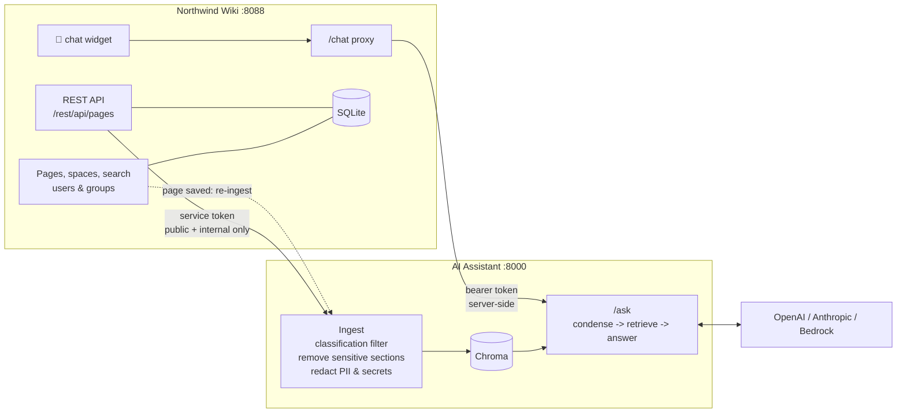

# Northwind Wiki + AI Assistant (RAG)

A realistic internal-knowledge setup:

- **Northwind Wiki** - a small Confluence-like wiki: spaces, pages, labels, versions, search, editing, users and groups, and page **classification** (public / internal / confidential).
- **AI Assistant** - a RAG chatbot that ingests the wiki through its REST API, answers **only** from indexed pages with **citations that link back to the wiki**, and is embedded in the wiki as a floating 💬 widget.
- **Sensitive data never reaches the LLM** - confidential pages, marked sensitive sections and secret/PII patterns are filtered before embedding, and leak tests prove it.

## Architecture



## How sensitive data is protected

| Layer | Mechanism | Example in the seed data |
|---|---|---|
| 1. Page access | Confidential pages are visible only to named groups in the wiki | Salary Bands 2026 → `hr` only |
| 2. API scope | The wiki REST API never returns confidential pages to the AI service account | Pentest report, FY2026 budget |
| 3. Connector check | The RAG connector skips any page that is not public/internal (defense in depth) | - |
| 4. Sensitive sections | `<!-- sensitive -->...<!-- /sensitive -->` is removed before embedding; the wiki shows it in a red 🔒 box | Payments DB break-glass credentials |
| 5. Pattern redaction | Phone, PAN, Aadhaar, card numbers, API keys, JWTs, passwords and connection strings | On-call engineer's mobile number |
| 6. Leak tests | Evaluation asks about restricted data and fails if any forbidden value appears | `python -m app.evaluate` |

## Demo users

| User | Role | Groups | Can see |
|---|---|---|---|
| Asha Rao | Software Engineer | employees, engineering | Public + internal |
| Ravi Menon | HR Business Partner | employees, hr | + Salary Bands |
| Meera Iyer | Security Lead | employees, security, engineering | + Pentest Report |
| Arjun Shah | Finance Manager | employees, finance | + Budget FY2026 |

Switch user from the top-right menu.

## Quick start (local)

```bash
python -m venv .venv
source .venv/Scripts/activate          # Windows Git Bash
pip install -r requirements-dev.txt
cp .env.example .env                   # add API keys and generate tokens

python -m pytest -v                    # no API keys needed

# Terminal 1 - wiki
python -m uvicorn wiki.app:app --port 8088 --reload

# Terminal 2 - index the wiki, then start the assistant
python -m app.ingest
python -m uvicorn app.api:app --port 8000
```

Open http://127.0.0.1:8088 and click 💬.

## Docker Compose

```bash
docker compose up --build
```

The assistant ingests the wiki on startup; page edits trigger a re-ingest automatically.

## Evaluation

```bash
python -m app.evaluate --retrieval-only   # embeddings only
python -m app.evaluate                    # full answers
```

| Metric | Meaning |
|---|---|
| Retrieval hit rate / MRR | The right page is retrieved, and how high it ranks |
| Answer accuracy | Expected facts appear in answers |
| Leak tests | Salary, credentials, pentest findings, budget and personal phone never appear |
| Correct refusals | Questions the wiki can't answer get "I don't know" |

## APIs

**Wiki** (`Authorization: Bearer <WIKI_API_TOKEN>`)

| Method | Endpoint | Purpose |
|---|---|---|
| GET | `/rest/api/pages` | Pages for integrations (never confidential) |
| GET | `/rest/api/spaces` | Spaces |
| POST | `/chat` | Chat widget proxy to the assistant (browser, no token) |

**Assistant** (`Authorization: Bearer <RAG_API_TOKEN>`)

| Method | Endpoint | Purpose |
|---|---|---|
| GET | `/health` | Health (no auth) |
| POST | `/ask` | `{"question": "...", "session_id": "optional"}` |
| POST | `/ingest` | Re-index the source |
| GET | `/stats` | Chunk count and providers |

## Reusing the chat widget in another app

```html
<link rel="stylesheet" href="/static/chat-widget.css">
<script src="/static/chat-widget.js" data-endpoint="/chat" data-title="Ask AI" defer></script>
```

The endpoint must accept `POST {question, session_id}` and return `{answer, sources, session_id}`. Keep the assistant token on the server side, as the wiki's `/chat` proxy does.

## Roadmap

- [ ] Permission-aware retrieval (index confidential pages with group metadata and filter by the asking user)
- [ ] Incremental sync using `updated_at` instead of full re-index
- [ ] Hybrid search (BM25 + vectors) and reranking
- [ ] pgvector or OpenSearch instead of local Chroma
- [ ] Compare with Amazon Bedrock Knowledge Bases + a Confluence data source
