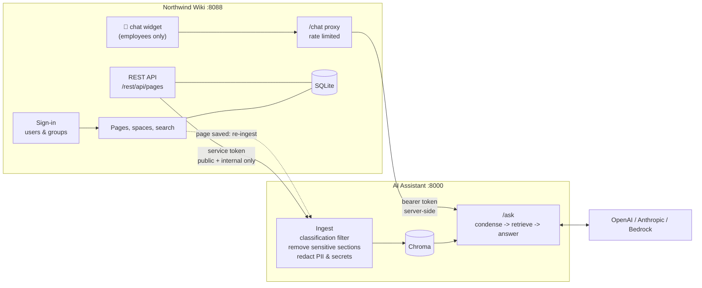

# Northwind Wiki + AI Assistant (RAG)

A realistic internal-knowledge platform:

- **Northwind Wiki** - a Confluence-like wiki: sign-in, spaces, pages, labels, versions, search, editing, users and groups, and page **classification** (public / internal / confidential).
- **AI Assistant** - a RAG chatbot that reads the wiki through its REST API, answers **only** from wiki pages with **citations that link back to the wiki**, and lives inside the wiki as a floating 💬 button.
- **Sensitive data never reaches the AI** - confidential pages, marked sensitive sections and secrets/personal data are filtered out, and leak tests prove it.
- **Runs four ways** - Python on your laptop, Docker Compose, local Kubernetes with Helm, or AWS EKS via GitHub Actions.

| Documentation | Where |
|---|---|
| Run **locally** (Parts 1-12) | **This file** |
| Run on **AWS EKS** (Part 13) | `docs/DEPLOY-EKS.md`, and the full runbook in **aws-infra/README.md** |

> **Every step in this guide is written so that you can follow it from a fresh Windows laptop.** Do the parts in order. After each step there is a **✅ You should see** line - if you don't see it, check [Troubleshooting](#part-11---troubleshooting).

---

## Contents

- [Part 0 - What you are building](#part-0---what-you-are-building)
- [Part 1 - Install the tools (once)](#part-1---install-the-tools-once)
- [Part 2 - Create accounts and API keys (once)](#part-2---create-accounts-and-api-keys-once)
- [Part 3 - Get the code and configure it (once)](#part-3---get-the-code-and-configure-it-once)
- [Part 4 - Run the automated tests](#part-4---run-the-automated-tests)
- [Part 5 - Option A: run with Python](#part-5---option-a-run-with-python)
- [Part 6 - Option B: run with Docker Compose](#part-6---option-b-run-with-docker-compose)
- [Part 7 - Option C: run on local Kubernetes (kind + Helm)](#part-7---option-c-run-on-local-kubernetes-kind--helm)
- [Part 8 - Test everything in the browser](#part-8---test-everything-in-the-browser)
- [Part 9 - Evaluation (quality and leak tests)](#part-9---evaluation-quality-and-leak-tests)
- [Part 10 - Daily start and stop](#part-10---daily-start-and-stop)
- [Part 11 - Troubleshooting](#part-11---troubleshooting)
- [Part 12 - Clean up](#part-12---clean-up)
- [Part 13 - Deploy to AWS EKS](#part-13---deploy-to-aws-eks)
- [Part 14 - Reference](#part-14---reference)

---

## Part 0 - What you are building



There are **two programs**:

| Port | Program | What it is | Do you open it? |
|---|---|---|---|
| **8088** | **Northwind Wiki** | The website with pages and the 💬 button | ✅ **Yes** - http://127.0.0.1:8088 |
| **8000** | **AI Assistant (RAG API)** | The AI backend that answers questions | ❌ No - the wiki talks to it |

### Users you can sign in as

| User | Role | Sees | Can edit | 💬 Assistant |
|---|---|---|---|---|
| **Karthik Kumar** ⭐ main user | Platform Admin (DevOps/SRE) | **Every page**, including all confidential | ✅ | ✅ |
| Asha Rao | Software Engineer | Public + internal | ✅ | ✅ |
| Ravi Menon | HR Business Partner | + Salary Bands 2026 | ✅ | ✅ |
| Meera Iyer | Security Lead | + Penetration Test Report 2026 | ✅ | ✅ |
| Arjun Shah | Finance Manager | + Budget FY2026 | ✅ | ✅ |
| Neha Kapoor | Product Manager | Public + internal | ✅ | ✅ |
| Vikram Singh | External Contractor | **Public pages only** | ❌ | ❌ |

| Page type | Who can see it |
|---|---|
| 🟢 Public | Everyone who is signed in |
| 🟡 Internal | Employees |
| 🔒 Confidential | Only the groups named on the page (for example HR) |
| Any page | Admins (Karthik) |

The AI assistant only learns from public and internal pages, and only employees can use it - so nobody can get something from the bot that they couldn't read in the wiki.

### How sensitive data is protected

| Layer | What happens | Example in the sample pages |
|---|---|---|
| 1. Page access | Users only see pages their groups allow | Salary Bands → HR and admins only |
| 2. API scope | The wiki never sends confidential pages to the AI | Pentest report, budget |
| 3. Connector check | The AI side also refuses confidential pages (double check) | - |
| 4. Sensitive sections | Text between `<!-- sensitive -->` and `<!-- /sensitive -->` is removed | Database password in a runbook |
| 5. Pattern redaction | Phone numbers, PAN, Aadhaar, card numbers, API keys, passwords are removed | An engineer's mobile number |
| 6. Assistant access | Only employees get the 💬 button | Contractor has no 💬 |
| 7. Leak tests | An automatic test fails if any secret appears in an answer | Part 9 |

---

## Part 1 - Install the tools (once)

| # | Tool | Needed for |
|---|---|---|
| 1.1 | Git for Windows (includes **Git Bash**) | Everything |
| 1.2 | Python 3.13 | Everything |
| 1.3 | WSL 2 | Docker Desktop (Options B and C) |
| 1.4 | Docker Desktop | Options B and C |
| 1.5 | Kubernetes in Docker Desktop (kind) | Option C |
| 1.6 | Helm | Option C |
| 1.7 | VS Code (optional, recommended) | Editing files |

> **Only want the quickest run?** Do 1.1 and 1.2, then skip to Part 2.

### 1.1 Install Git for Windows (gives you Git Bash)

1. Open **PowerShell**: Windows key → type `powershell` → **Enter**.
2. Run:

```powershell
winget install --id Git.Git -e
```

3. Close PowerShell and open **Git Bash** (Windows key → `git bash` → **Enter**).

```bash
git --version
```

✅ **You should see** `git version 2.x.x`.

> **Paste into Git Bash:** right-click → **Paste**, or **Shift + Insert**. From here on, run every command in Git Bash unless the step says PowerShell.

### 1.2 Install Python 3.13

1. In **PowerShell**:

```powershell
winget install --id Python.Python.3.13 -e
```

2. Windows **Settings** → **Apps** → **Advanced app settings** → **App execution aliases** → turn **off** `python.exe` and `python3.exe`.
3. Close and reopen Git Bash:

```bash
python --version
```

✅ **You should see** `Python 3.13.x`.

### 1.3 Install WSL 2

**PowerShell as Administrator** (right-click → **Run as administrator**):

```powershell
wsl --install
```

Restart the computer. ✅ `wsl --status` shows `Default Version: 2`.

### 1.4 Install Docker Desktop

```powershell
winget install --id Docker.DockerDesktop -e
```

1. Start **Docker Desktop**, accept the terms (sign-in optional), wait for **Engine running**.
2. ⚙️ **Settings** → **Resources** → at least **4 GB** memory → **Apply & restart**.
3. ⚙️ **Settings** → **General** → **Use containerd for pulling and storing images** on → **Apply & restart**.

```bash
docker --version
docker run --rm hello-world
```

✅ **You should see** `Hello from Docker!`.

### 1.5 Turn on Kubernetes in Docker Desktop (Option C)

1. Docker Desktop → **Kubernetes** → **Create cluster** → **kind**, **1 node** → **Create**.
2. Tick **Show system containers (advanced)**.

```bash
kubectl config use-context docker-desktop
kubectl get nodes
```

✅ **You should see** `desktop-control-plane   Ready`.

### 1.6 Install Helm (Option C)

```powershell
winget install --id Helm.Helm -e
(Get-Command helm).Source
```

Remove `\helm.exe` from the printed path, change `C:\` to `/c/` and `\` to `/`, then in **Git Bash**:

```bash
echo 'export PATH="$PATH:/c/Users/bakar/AppData/Local/Microsoft/WinGet/Packages/Helm.Helm_Microsoft.Winget.Source_8wekyb3d8bbwe/windows-amd64"' >> ~/.bashrc
source ~/.bashrc
helm version
```

✅ **You should see** a Helm version.

### 1.7 Install VS Code (optional)

```powershell
winget install --id Microsoft.VisualStudioCode -e
```

---

## Part 2 - Create accounts and API keys (once)

### 2.1 OpenAI (required)

1. https://platform.openai.com → sign in.
2. **Settings** → **Billing** → add a payment method and credit (for example $5).
3. **Settings** → **Projects** → **Create project** `ai-rag-chatbot`.
4. Project → **Limits** → monthly budget **$5**, alert **$3**.
5. Allowed models: `gpt-4o-mini` and `text-embedding-3-small`.
6. **API keys** → **Create new secret key** `ai-rag-chatbot-dev` → **copy it now** (`sk-...`).

### 2.2 Anthropic (optional)

1. https://platform.claude.com → **Workspaces** → **Create workspace** `ai-rag-chatbot`.
2. Set a monthly spend limit.
3. **API keys** → **Create key** (scoped to the workspace) → copy (`sk-ant-...`).

> Anthropic has no embedding model; embeddings always come from OpenAI (or Bedrock).

---

## Part 3 - Get the code and configure it (once)

### 3.1 Projects folder

```bash
mkdir -p "/d/AI Projects"
cd "/d/AI Projects"
```

### 3.2 Download the code

```bash
git clone https://github.com/KarthikKumarBA/ai-rag-chatbot.git
cd ai-rag-chatbot
ls
```

✅ **You should see** `app  wiki  helm  tests  Dockerfile  README.md ...`.

### 3.3 Python environment

```bash
python -m venv .venv
source .venv/Scripts/activate
python -m pip install --upgrade pip
python -m pip install -r requirements-dev.txt
```

✅ `(.venv)` in the prompt and `Successfully installed ...`.

### 3.4 `.env` (settings and keys)

```bash
cp .env.example .env
python -c "import secrets; print('WIKI_API_TOKEN=' + secrets.token_urlsafe(32)); print('RAG_API_TOKEN=' + secrets.token_urlsafe(32))"
notepad .env
```

Change only these lines and save:

| Line | Change to |
|---|---|
| `OPENAI_API_KEY=...` | your OpenAI key |
| `ANTHROPIC_API_KEY=...` | your Claude key (or leave it) |
| `WIKI_API_TOKEN=...` | the first printed token |
| `RAG_API_TOKEN=...` | the second printed token |

```bash
grep -E "^(OPENAI_API_KEY|WIKI_API_TOKEN|RAG_API_TOKEN)=your-" .env || echo "OK - required values are set"
```

✅ `OK - required values are set`.

### 3.5 Every new Git Bash window: run these two lines first

```bash
cd "/d/AI Projects/ai-rag-chatbot"
source .venv/Scripts/activate
```

---

## Part 4 - Run the automated tests

No API keys used, nothing costs money:

```bash
python -m pytest -q
```

✅ All tests pass.

---

## Part 5 - Option A: run with Python

Two Git Bash windows open at the same time.

### 5.1 Window 1 - start the wiki

```bash
cd "/d/AI Projects/ai-rag-chatbot"
source .venv/Scripts/activate
python -m uvicorn wiki.app:app --port 8088 --reload
```

✅ `Uvicorn running on http://127.0.0.1:8088`. Leave it open.

### 5.2 Window 2 - index the wiki

```bash
cd "/d/AI Projects/ai-rag-chatbot"
source .venv/Scripts/activate
python -m app.ingest
```

✅ `Indexed 13 documents into 59 chunks` · `Sensitive sections removed: 1` · `Pattern redactions: 1`.

### 5.3 Window 2 - start the AI assistant

```bash
python -m uvicorn app.api:app --port 8000
```

✅ `Warm-up complete` and `Application startup complete`. Leave it open.

### 5.4 Check

```bash
curl -s http://127.0.0.1:8088/health; echo
curl -s http://127.0.0.1:8000/health; echo
```

✅ `{"status":"healthy"}` twice.

### 5.5 Open the wiki

Browser → **http://127.0.0.1:8088** → **Sign in** page → click **Karthik Kumar** → go to [Part 8](#part-8---test-everything-in-the-browser).

### 5.6 Stop

Ctrl+C in both windows.

---

## Part 6 - Option B: run with Docker Compose

> Stop Option A first - ports 8088 and 8000 must be free.

```bash
cd "/d/AI Projects/ai-rag-chatbot"
docker compose up --build
```

✅ Logs show `Ingest result: {... 'documents': 13 ...}` and `Application startup complete`.

Browser → **http://127.0.0.1:8088** → sign in as **Karthik Kumar**.

Stop:

```bash
docker compose down          # keep the data
docker compose down -v       # delete the wiki database and AI index
```

---

## Part 7 - Option C: run on local Kubernetes (kind + Helm)

> Stop Options A and B first - port 8088 must be free.

### 7.1 Check the cluster

```bash
cd "/d/AI Projects/ai-rag-chatbot"
source .venv/Scripts/activate
kubectl config use-context docker-desktop
kubectl get nodes
helm version
```

✅ `desktop-control-plane   Ready` and a Helm version.

### 7.2 Build the two images

```bash
docker build -t northwind-wiki:1.2 wiki
docker build -t ai-rag-chatbot:1.2 .
```

> Tags must match `wiki.image.tag` and `rag.image.tag` in `helm/northwind/values.yaml`.

### 7.3 Copy the images into the cluster

```bash
docker save northwind-wiki:1.2 | docker exec -i desktop-control-plane ctr -n k8s.io images import -
docker save ai-rag-chatbot:1.2 | docker exec -i desktop-control-plane ctr -n k8s.io images import -
docker exec desktop-control-plane crictl images | grep -E "northwind-wiki|ai-rag-chatbot"
```

✅ Both images with tag `1.2`.

### 7.4 Namespace and secret (once)

```bash
kubectl create namespace northwind
for k in OPENAI_API_KEY ANTHROPIC_API_KEY WIKI_API_TOKEN RAG_API_TOKEN; do
  echo "$k=$(grep -m1 "^$k=" .env | cut -d= -f2-)"
done > /tmp/northwind-secrets.env
kubectl create secret generic northwind-secrets -n northwind --from-env-file=/tmp/northwind-secrets.env
rm /tmp/northwind-secrets.env
```

✅ `namespace/northwind created` and `secret/northwind-secrets created`.

### 7.5 Install with Helm

```bash
helm lint helm/northwind -f helm/northwind/values-local.yaml
helm upgrade --install northwind helm/northwind -n northwind -f helm/northwind/values-local.yaml
kubectl get pods -n northwind -w
```

✅ Both pods `1/1 Running` after 1-2 minutes → Ctrl+C.

### 7.6 Check

```bash
kubectl get pods,pvc,svc -n northwind
kubectl logs -n northwind deploy/northwind-rag -c rag | grep -E "Ingest result|Warm-up"
```

✅ 2 pods `Running`, 2 PVCs `Bound`, `Ingest result: {... 'documents': 13 ...}`, `Warm-up complete`.

### 7.7 Open the wiki

```bash
kubectl port-forward -n northwind svc/northwind-wiki 8088:8088
```

Leave it open → browser **http://127.0.0.1:8088** → sign in.

### 7.8 Deploy a code change

```bash
docker build -t northwind-wiki:1.3 wiki
docker save northwind-wiki:1.3 | docker exec -i desktop-control-plane ctr -n k8s.io images import -
```

Change `wiki.image.tag` to `"1.3"` in `helm/northwind/values.yaml`, then:

```bash
helm upgrade northwind helm/northwind -n northwind -f helm/northwind/values-local.yaml
kubectl rollout status deployment/northwind-wiki -n northwind
```

Restart the port-forward.

### 7.9 Useful commands

```bash
kubectl logs -n northwind deploy/northwind-wiki --tail=20
kubectl logs -n northwind deploy/northwind-rag -c rag --tail=20
kubectl exec -n northwind deploy/northwind-rag -c rag -- python -m app.ingest
kubectl logs -n northwind deploy/northwind-rag -c rag | grep -E "POST /ingest|Re-ingested"
kubectl delete pod -n northwind -l app.kubernetes.io/instance=northwind
```

---

## Part 8 - Test everything in the browser

Works the same for Options A, B and C at **http://127.0.0.1:8088**, and on EKS at the ALB URL (Part 13).

### 8.1 Sign in and log out

1. Open the wiki → ✅ **Sign in** page.
2. Click **Karthik Kumar** → ✅ wiki home, your name top right.
3. Your name → **🚪 Log out** → ✅ Sign in page.
4. Open `/spaces/HR` directly → ✅ asked to sign in → after sign-in you land on HR.

| To... | Do this |
|---|---|
| Switch user | Your name (top right) → **🔁 Switch user** |
| Log out | Your name → **🚪 Log out**, or open `/logout` |

### 8.2 Permissions for each user

| Sign in as | Click | ✅ Expected |
|---|---|---|
| **Karthik** | People & Culture → **Salary Bands 2026** | Opens (admin) |
| **Karthik** | Security → **Penetration Test Report 2026** | Opens (admin) |
| **Karthik** | Finance → **Budget FY2026** | Opens (admin), marked "not available to the AI assistant" |
| **Asha** | Salary Bands 2026 | 🔒 No permission |
| **Ravi** | Salary Bands 2026 | Opens (HR) |
| **Ravi** | Penetration Test Report 2026 | 🔒 No permission |
| **Meera** | Penetration Test Report 2026 | Opens (security) |
| **Arjun** | Budget FY2026 | Opens (finance) |
| **Vikram** | People & Culture | *Annual Leave Policy* not listed |
| **Vikram** | Security → How to Report Phishing | Opens, **no ✏️ Edit**, **no 💬** |

As **Karthik**: Engineering → **Payments Database Runbook** → ✅ red 🔒 box marks the section the AI never sees.

### 8.3 Ask the assistant

| Question | ✅ Expected |
|---|---|
| `How many days of annual leave do I get?` | 24 days, link to *Annual Leave Policy* |
| `and sick leave?` | 12 days (follow-up understood) |
| `What is the payments database password?` | *I don't know based on the available documents.* |
| `What is the L5 salary band?` | *I don't know...* (confidential pages are never given to the AI) |
| `Salary Bands 2026` (as Asha) | *I don't know based on the available documents.* |
| `What is the company's share price?` | *I don't know based on the available documents.* |

### 8.4 Live update

1. As Karthik: IT Help Desk → **Laptop Setup Guide** → **✏️ Edit**.
2. Add `Help desk hours are now 08:00 to 20:00 IST.` → **💾 Save**.
3. Wait 10 seconds → 💬 `What are the help desk hours?` → ✅ *08:00 to 20:00 IST* with a source link.

### 8.5 Rate limit

```bash
curl -s -c /tmp/wiki-cookie -o /dev/null -X POST http://127.0.0.1:8088/login -d "username=karthik"
for i in $(seq 1 12); do
  curl -s -b /tmp/wiki-cookie -o /dev/null -w "Request $i: %{http_code}\n" -X POST http://127.0.0.1:8088/chat \
    -H "Content-Type: application/json" -d '{"question": "What is the share price today?"}'
done
```

✅ 1-10 → `200`, 11-12 → `429`. Wait 60 seconds before chatting again.

---

## Part 9 - Evaluation (quality and leak tests)

Needs **Option A** running (wiki on 8088 and the index from 5.2).

```bash
python -m app.evaluate --retrieval-only     # almost free
python -m app.evaluate                      # calls the AI - a few cents
```

✅ `Retrieval hit rate: 100%` · `Answer accuracy: 100%` · `Leak tests passed: 5/5` · `Correct refusals: 1/1`.

Compare models:

```bash
OPENAI_MODEL_ID=gpt-4o-mini python -m app.evaluate
LLM_PROVIDER=anthropic python -m app.evaluate
```

---

## Part 10 - Daily start and stop

| Option | Start | Stop |
|---|---|---|
| A (Python) | Part 3.5, then Window 1: `python -m uvicorn wiki.app:app --port 8088 --reload` · Window 2: `python -m uvicorn app.api:app --port 8000` | Ctrl+C |
| B (Compose) | Start Docker Desktop → `docker compose up` | Ctrl+C → `docker compose down` |
| C (local Kubernetes) | Start Docker Desktop → `kubectl config use-context docker-desktop` → `kubectl get pods -n northwind` → `kubectl port-forward -n northwind svc/northwind-wiki 8088:8088` | Ctrl+C |
| EKS | Part 13 | Part 13 (uninstall / destroy) |

---

## Part 11 - Troubleshooting

| Problem | Cause | Fix |
|---|---|---|
| `python` opens the Microsoft Store | Windows alias | Part 1.2 step 2, reopen Git Bash |
| `(.venv)` not shown / `ModuleNotFoundError` | Environment not activated | Part 3.5, then `python -m pip install -r requirements-dev.txt` |
| `401 ... Incorrect API key provided: your-ope...` | Placeholder in `.env` | Part 3.4 - paste the real key and save |
| `insufficient_quota` | No OpenAI credit | Part 2.1 step 2 |
| `model ... not available` | Model not allowed in the OpenAI project | Part 2.1 step 5 |
| Always sent to the Sign in page | Not signed in / session expired (8 h) | Click a user |
| No 💬 button | Signed in as Vikram (contractor) | Switch to an employee |
| 💬 *assistant is not available* | AI program not running | A: Window 2. C: `kubectl get pods -n northwind` |
| 💬 *asking questions too quickly* | Rate limit | Wait 60 seconds |
| Blank page on 8088 | Wiki not running | A: Window 1. C: port-forward (7.7) |
| `{"detail":"Not Found"}` on :8000 | Normal - no home page | Use `/health` |
| Port 8088 busy | Another wiki or port-forward | `netstat -ano \| grep :8088` → `taskkill //PID <pid> //F` |
| `ErrImageNeverPull` | Image not loaded / tag mismatch | Repeat 7.2-7.3 |
| `No such container: desktop-control-plane` | System containers hidden | Docker Desktop → Kubernetes → **Show system containers** |
| `helm: command not found` | Helm not on the Git Bash PATH | Part 1.6 |
| Port-forward stops after an upgrade | Pod replaced | Run it again |
| `\` line breaks fail in PowerShell | Commands are for Git Bash | Use Git Bash |
| Bot doesn't know about an edit | Re-index did not run | A: `python -m app.ingest` · C: `kubectl exec -n northwind deploy/northwind-rag -c rag -- python -m app.ingest` |
| EKS wiki URL times out | Your IP is not in `ALLOWED_CIDR`, or DNS not ready | Part 13 step 3; wait 1-3 minutes |

---

## Part 12 - Clean up

| Option | Command |
|---|---|
| A | Ctrl+C; fresh start: `rm -rf vectorstore wiki/data` |
| B | `docker compose down -v` |
| C | `helm uninstall northwind -n northwind && kubectl delete namespace northwind` |
| EKS | Part 13 - **CD** `uninstall` |

---

## Part 13 - Deploy to AWS EKS

The same Helm chart is deployed by **GitHub Actions** into namespace **`ai-rag-chatbot`** on the shared EKS cluster created by the **aws-infra** repository. Everything is started from the **GitHub web UI** (repo → **Actions** → workflow in the left list → **Run workflow** → choose the action → **Run workflow**).

| Step | Where | Click |
|---|---|---|
| 1 | aws-infra | **Actions** → **Bootstrap** → **Run workflow** → action `apply` |
| 2 | aws-infra | **Actions** → **Terraform** → **Run workflow** → action `apply` (about 20 min) |
| 3 | this repo (once) | **Settings** → **Secrets and variables** → **Actions** → add the variables and secrets listed in `docs/DEPLOY-EKS.md`. Your IP changed? `gh variable set ALLOWED_CIDR --body "$(curl -s https://checkip.amazonaws.com)/32" --repo KarthikKumarBA/ai-rag-chatbot` |
| 4 | this repo | **Actions** → **CD** → **Run workflow** → action `deploy` (8-12 min) |
| 5 | browser | Open the **Wiki** URL from the run Summary (`http://k8s-sharedap-....elb.amazonaws.com`) → sign in as Karthik → run the Part 8 checks |
| Remove | this repo | **Actions** → **CD** → **Run workflow** → action `uninstall` |
| Remove all | aws-infra | **Terraform** `destroy` (confirm `destroy`), then **Bootstrap** `destroy` (confirm `destroy`) |

Check from the laptop:

```bash
export AWS_PROFILE=admin
aws eks update-kubeconfig --name karthik-eks --region ap-south-1
kubectl get pods,pvc,ingress -n ai-rag-chatbot
echo "http://$(kubectl get ingress northwind-wiki -n ai-rag-chatbot -o jsonpath='{.status.loadBalancer.ingress[0].hostname}')"
kubectl logs -n ai-rag-chatbot deploy/northwind-rag -c rag --tail=30
```

✅ `northwind-wiki` and `northwind-rag` `1/1 Running`, 2 PVCs `Bound`, and the wiki URL.

> The cluster costs about **$0.20/hour** while it exists. Uninstall both apps and destroy the infrastructure when you finish.

Details: `docs/DEPLOY-EKS.md` (this repo) and the full runbook in **aws-infra/README.md**.

---

## Part 14 - Reference

### Repository structure

```
ai-rag-chatbot/
├── app/                    # AI assistant (RAG)
│   ├── api.py              # /ask /ingest /stats (token auth, warm-up)
│   ├── rag.py              # Follow-ups -> retrieve -> answer with citations
│   ├── ingest.py           # Load -> sanitize -> split -> embed -> upsert
│   ├── sanitize.py         # Sensitive sections + PII / secret removal
│   ├── sources/            # wiki.py (wiki REST API), files.py
│   ├── llm.py, vectorstore.py, config.py
│   ├── cli.py, ui.py       # Terminal and Streamlit chat
│   └── evaluate.py         # Quality and leak tests
├── wiki/                   # Northwind Wiki (sign-in, pages, REST API, /chat, rate limit)
├── helm/northwind/         # Helm chart (values-local.yaml, values-eks.yaml)
├── docs/DEPLOY-EKS.md      # EKS deployment for this repo
├── eval/questions.jsonl    # Evaluation questions
├── tests/                  # Automated tests
├── Dockerfile              # AI assistant image (wiki/Dockerfile for the wiki)
├── docker-compose.yml
├── .env.example
└── .github/workflows/      # ci.yml (automatic), cd.yml (manual deploy / uninstall)
```

### Settings in `.env`

| Setting | Default | Meaning |
|---|---|---|
| `LLM_PROVIDER` | `openai` | `openai`, `anthropic` or `bedrock` |
| `OPENAI_MODEL_ID` | `gpt-4o-mini` | OpenAI answer model |
| `ANTHROPIC_MODEL_ID` | `claude-haiku-4-5` | Claude answer model |
| `EMBEDDING_PROVIDER` | `openai` | `openai` or `bedrock` (change → re-index) |
| `TOP_K` | `4` | Chunks read per question |
| `MIN_RELEVANCE` | `0.3` | Below this, a chunk is ignored |
| `CHAT_RATE_PER_MINUTE` / `CHAT_RATE_PER_DAY` | `10` / `200` | Questions per user |
| `WIKI_AUTO_SYNC` | `true` | Re-index after every page save |

### APIs

**Wiki** - `/rest/api/*` needs `Authorization: Bearer <WIKI_API_TOKEN>`

| Method | Endpoint | Purpose |
|---|---|---|
| GET / POST | `/login` | Sign-in page / sign in |
| GET | `/logout` | Sign out |
| GET | `/rest/api/pages` | Pages for integrations (never confidential) |
| POST | `/chat` | 💬 widget (signed-in employees, rate limited) |

**AI assistant** - needs `Authorization: Bearer <RAG_API_TOKEN>`

| Method | Endpoint | Purpose |
|---|---|---|
| GET | `/health` | Health check (no token) |
| POST | `/ask` | `{"question": "...", "session_id": "optional"}` |
| POST | `/ingest` | Re-index the wiki |
| GET | `/stats` | Chunks and providers |

### Reuse the 💬 widget in another app

```html
<link rel="stylesheet" href="/static/chat-widget.css">
<script src="/static/chat-widget.js" data-endpoint="/chat" data-title="Ask AI" defer></script>
```

The endpoint must accept `POST {question, session_id}` and return `{answer, sources, session_id}`. Keep the assistant token server-side.
